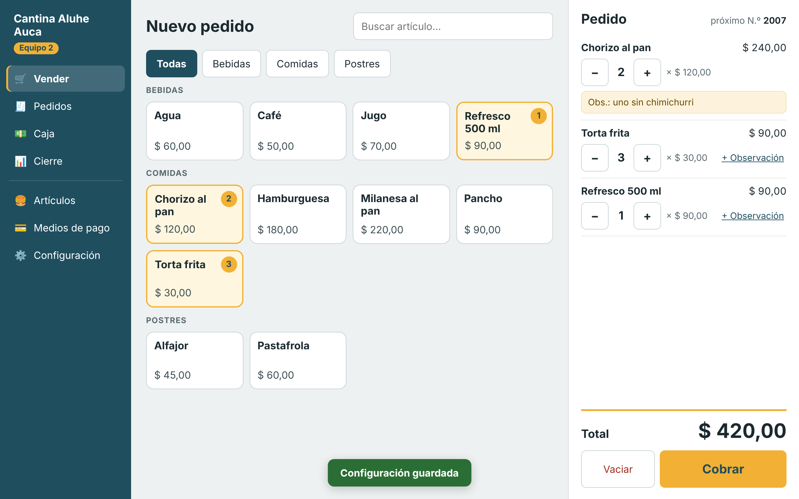
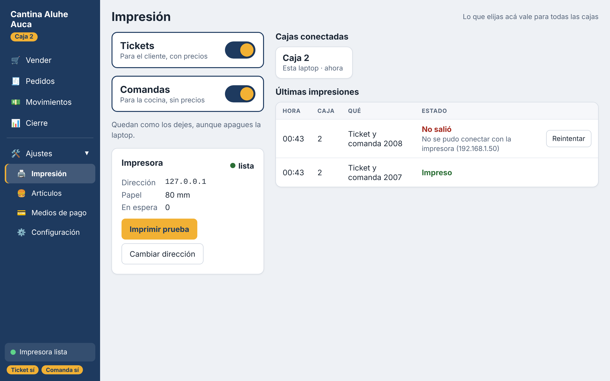

# Cantina Aluhe Auca

App para tomar pedidos, cobrar, generar ticket y comanda, y cerrar la caja.
Es una PWA: funciona en Windows y Android, se instala desde el navegador y
**cada caja (dispositivo) guarda sus propios datos**. La laptop hace de servidor para imprimir.



- [Esquema del programa](docs/esquema.md): qué hace, decisiones tomadas, numeración y datos.
- [Capturas de todas las pantallas](docs/esquema.md#pantallas)

## Estado

👉 **[Plan de trabajo](docs/plan.md):** qué está hecho, qué falta y en qué orden.
🤖 **[CLAUDE.md](CLAUDE.md):** contexto, decisiones y forma de trabajo para agentes de IA que colaboren en el proyecto.

| Etapa | Contenido | Estado |
|---|---|---|
| 1 | Base, configuración de la caja, artículos, medios de pago | ✅ Lista |
| 2 | Vender, cobrar, ticket, comanda, pedidos y anulación | ✅ Lista |
| 3 | Movimientos (entradas y salidas de caja), cierre, exportaciones y respaldo | ✅ Lista |
| 4 | Impresión por red, con la laptop como servidor | ✅ Código listo · falta probar con la impresora real |
| 5 | Sumar una caja en un minuto (QR, carta desde la laptop) | Pendiente |
| 6 | Consolidar todas las cajas en la laptop | Pendiente |
| 7 | Documentación ágil para los usuarios | Pendiente |
| 8 | Ensayo general y preparación del evento | Pendiente |

## Usarla en el evento



**En la laptop (Caja 1 y servidor)**

1. Doble clic en **`iniciar-cantina.bat`**. Se abre una ventana negra (el servidor) y el navegador en `http://localhost:8080`.
   La primera vez, Windows pregunta por el firewall: **permitir en redes privadas**.
2. En **Ajustes › Impresión**, tocá *Cambiar dirección*, escribí la IP de la impresora y tocá *Imprimir prueba*.
3. No cierres la ventana negra mientras dure el evento: ahí también se ve cada impresión.

**En cada tablet**

- Abrí Chrome en la dirección que muestra la ventana negra en *"En las tablets"* (por ejemplo `http://192.168.1.10:8080`).
- La tablet y la laptop tienen que estar en la misma red (el router de la cantina).

**Qué hace el servidor** (`servidor/Cantina.java`, Java 21, no hay que compilar): sirve la app,
y manda los tickets y las comandas a la impresora (`IP:9100`, ESC/POS, papel de 80 mm), de a uno y en orden.
Los interruptores **Tickets** y **Comandas** se cambian solo desde la laptop, valen para todas las cajas
y quedan guardados en `servidor/cantina.properties`. **No guarda ventas**: cada caja guarda las suyas.

Si la impresión falla, la venta ya está guardada: se puede *Reintentar* o *Seguir sin imprimir*.
Desde **Pedidos** se reimprime el ticket o la comanda de cualquier pedido.

**Al final del día:** cada caja imprime su resumen desde **Cierre** (por artículo y por medio de pago) y toca
**Mandar a la laptop**. En la laptop, **Cierre › Todas las cajas** suma todo e imprime el total.

> Los datos quedan guardados en el navegador **para esa dirección exacta**.
> Abrila siempre con la misma dirección y el mismo navegador, o vas a ver la app vacía.
> Por eso conviene que la laptop tenga **IP fija** en el router.

Sin la laptop (por ejemplo, con otro servidor web) la app vende igual, pero no imprime:
el ticket y la comanda se ven en pantalla.

## Numeración

Cada dispositivo que vende es una **caja**, y elige su número la primera vez que se abre la app.

- **Cajas 1 a 7: venta.** La caja 2 numera del 2000 al 2999, y así.
  Sus datos nunca se borran.
- **Cajas 8 y 9: prueba.** Muestran una franja amarilla "MODO PRUEBA" y se
  pueden resetear desde Ajustes › Configuración (borra pedidos y movimientos; mantiene la carta).

## Archivos que genera

Casi todo sale de **Cierre › Exportaciones**. Exporta todo lo de la caja, sin los
pedidos anulados (que tienen su propia tabla).

| Archivo | Contenido |
|---|---|
| `ventas-cajaN-fecha.xlsx` | Excel con 3 pestañas: Ventas por ticket, Por medio de pago (con total) y Por artículo (con total) |
| `ventas-por-ticket-cajaN-fecha.csv` | Pedido, Fecha, Hora, Caja, Medio de pago, Venta |
| `por-medio-de-pago-cajaN-fecha.csv` | Medio, Pedidos, Monto |
| `por-articulo-cajaN-fecha.csv` | Artículo, Categoría, Cantidad, Ventas |
| `movimientos-cajaN-fecha.csv` | Hora, Tipo, Comprobante, Monto, Motivo, Quién |
| `anulados-cajaN-fecha.csv` | Pedido, Hora, Anulado a las, Medio, Monto |
| `cierre-cajaN-fecha.json` | Resumen y detalle completo (con costo y ganancia), para consolidar todas las cajas |
| `carta-cajaN-fecha.json` | Artículos y medios de pago (también desde Artículos › Exportar carta) |
| `respaldo-cajaN-fecha-hora.json` | Todo el dispositivo, desde Ajustes › Configuración, para restaurarlo |

Los CSV van separados por `;` y con coma decimal (Excel en español). Los archivos de las
cajas de prueba llevan `-PRUEBA` en el nombre. Costo y ganancia no salen en las planillas.

## Cómo está hecha

HTML, CSS y JavaScript simples, sin herramientas de compilación.

```
index.html               la página
css/estilos.css          colores y diseño
js/util.js               formato de dinero, ventanas, avisos
js/db.js                 almacenamiento del dispositivo (IndexedDB)
js/datos.js              reglas de negocio (validaciones, carta, reseteo)
js/app.js                arranque y menú
js/pantallas/*.js        una pantalla por archivo
js/documentos.js         ticket, comanda y comprobantes de caja (en pantalla)
js/escpos.js             ticket y comanda para la impresora térmica (ESC/POS, 80 mm)
js/impresion.js          habla con el servidor de la laptop: imprimir, reintentar, interruptores
js/resumen.js            resumen del día por caja y total de todas las cajas
js/exportaciones.js      tablas de exportación, CSV y Excel
js/xlsx.js               generador de archivos Excel sin librerías
sw.js                    permite abrirla sin internet
servidor/Cantina.java    servidor de la laptop: sirve la app y reenvía las impresiones
iniciar-cantina.bat      arranca el servidor en Windows
docs/                    esquema del programa y capturas
borradores/              versiones guardadas que la app no usa (por ejemplo, exportaciones con filtros)
manifest.webmanifest     nombre e ícono al instalarla
```

Los montos se guardan en **centésimos** (enteros): $ 120,50 se guarda como 12050.
