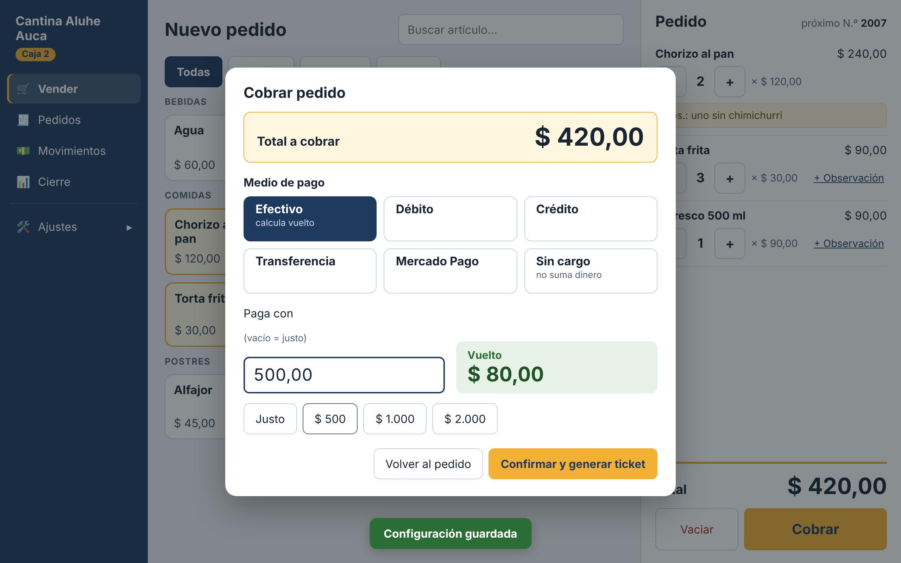
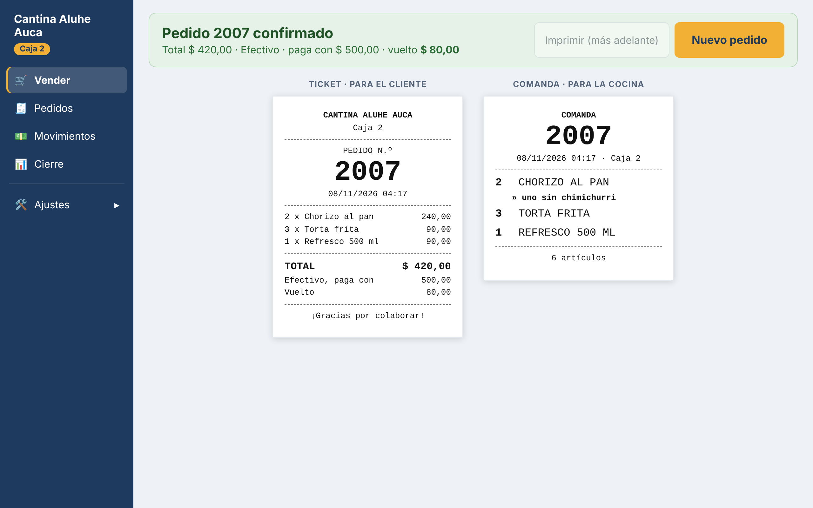
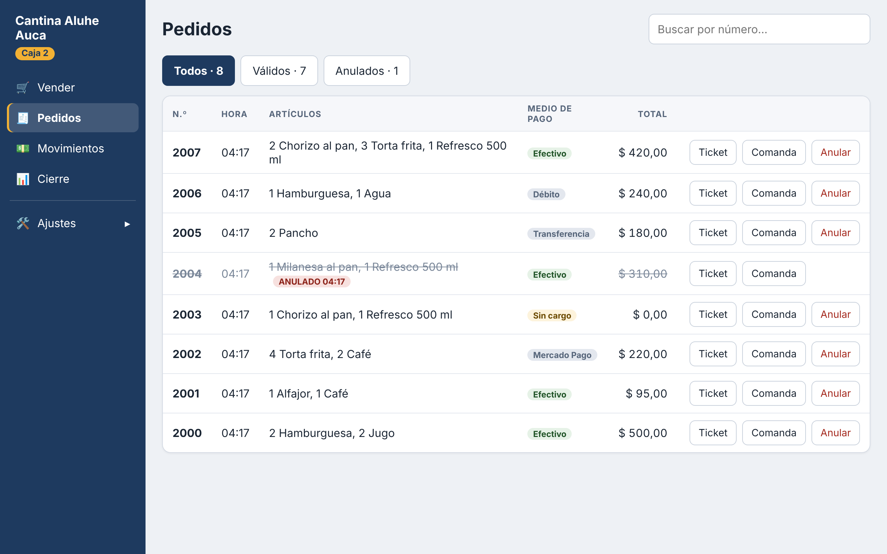
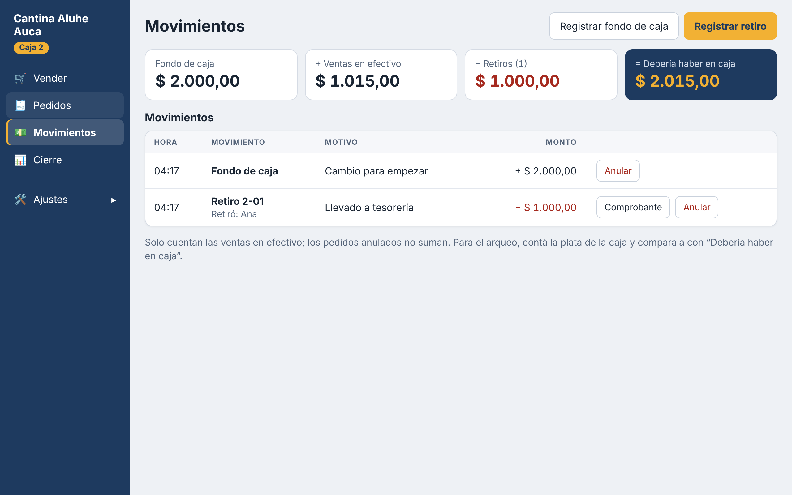
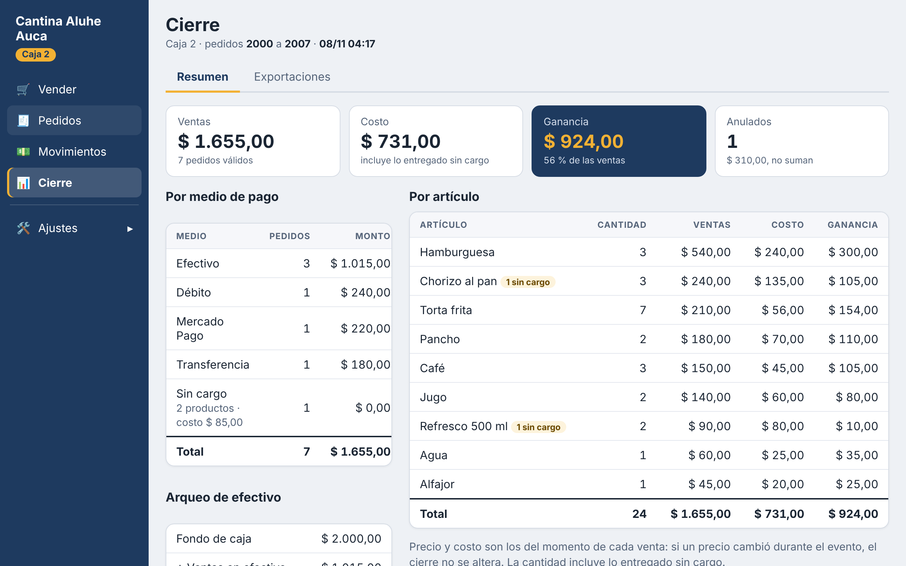
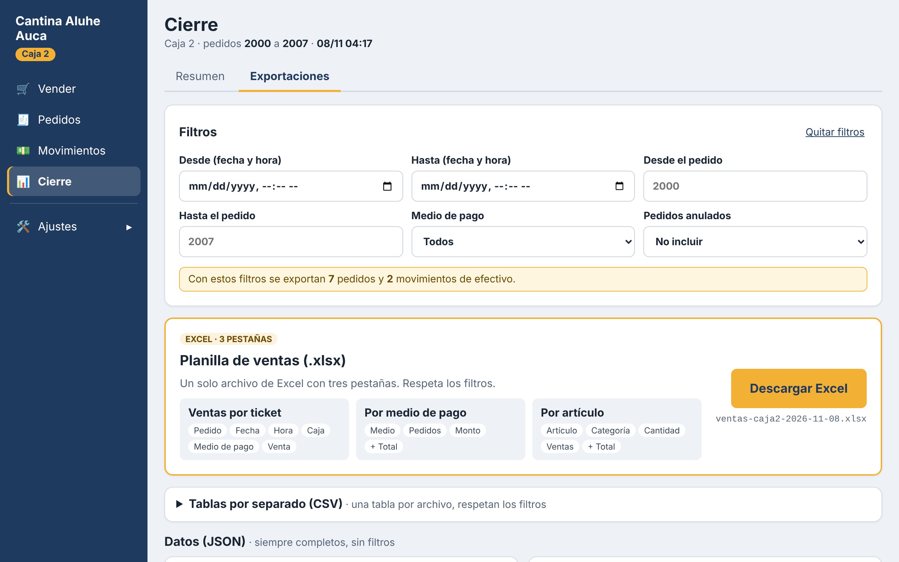
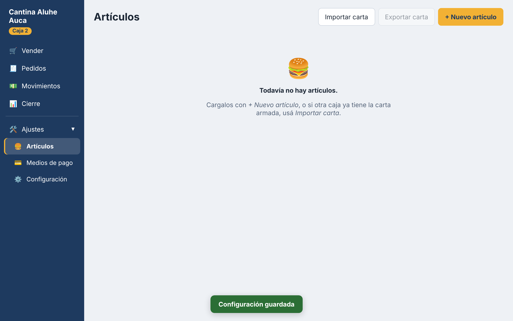
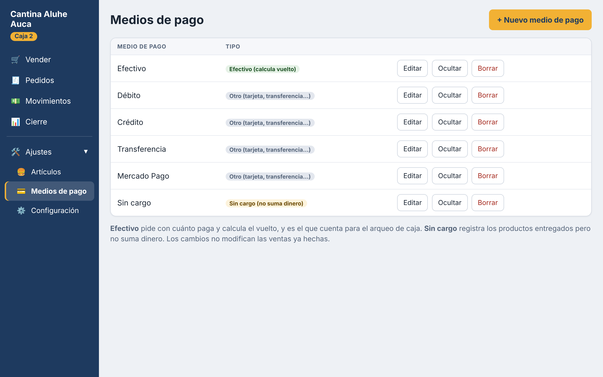

# Esquema del programa — Cantina Aluhe Auca

Una app instalable (PWA) para Windows y Android. Un empleado carga el pedido de
un cliente anónimo, cobra con un medio de pago y la app genera el ticket y la
comanda con el mismo número. Cada dispositivo que vende es una **caja**, y cada
caja guarda sus propios datos, sin red y sin servidor.

## Cómo es un pedido

Elegir artículos → observaciones → cobrar (un medio de pago) → **ticket + comanda** (mismo número) → queda en Pedidos (se puede anular).

## Menú

- **Siempre a la vista:** Vender, Pedidos, Movimientos, Cierre.
- **Desplegable "Ajustes":** Artículos, Medios de pago, Configuración.

## Pantallas

| # | Pantalla | Qué hace |
|---|---|---|
| 1 | Primera vez | Elegir el número de caja (1 a 7 venta, 8 y 9 prueba), nombre de la cantina y pie del ticket |
| 2 | Vender | Botones por artículo agrupados por categoría, buscador, cantidades con + y −, observación por línea, total |
| 3 | Cobrar | Un medio de pago; en efectivo "paga con" y vuelto, con montos rápidos |
| 4 | Ticket y comanda | Ticket con precios para el cliente; comanda sin precios para la cocina; mismo número |
| 5 | Pedidos | Lista con búsqueda y filtros, volver a ver ticket o comanda, anular |
| 6 | Movimientos | Fondo de caja, retiros con comprobante numerado, lo que debería haber en la caja |
| 7 | Cierre › Resumen | Ventas, costo y ganancia; por medio de pago y por artículo; arqueo de efectivo |
| 8 | Cierre › Exportaciones | Filtros, Excel con 3 pestañas, 5 tablas CSV y 2 archivos JSON |
| 9 | Artículos | Nombre, categoría y precio (obligatorios), costo opcional; ocultar; exportar e importar la carta |
| 10 | Medios de pago | Efectivo (calcula vuelto), otros, y sin cargo (no suma dinero) |

### 1 · Primera vez

### 2 · Vender

### 3 · Cobrar

### 4 · Ticket y comanda

### 5 · Pedidos

### 6 · Movimientos

### 7 · Cierre › Resumen

### 8 · Cierre › Exportaciones

### 9 · Artículos

### 10 · Medios de pago

*Las capturas usan datos de ejemplo.*

## Decisiones tomadas

- **Tecnología:** PWA (HTML + JavaScript), una sola app para Windows y Android.
- **Datos:** cada caja guarda los suyos y nunca se borran, salvo en las cajas de prueba 8 y 9, que se pueden resetear.
- **Clientes:** anónimos, no se registra nada de ellos.
- **Empleado:** no se registra quién tomó el pedido.
- **Pago:** un solo medio por pedido, sin pagos divididos.
- **Sin cargo:** es un medio de pago; cuenta productos y su costo, no dinero.
- **Ganancia:** cada artículo puede tener costo (si no, es 0); cada venta guarda una copia del precio y del costo de ese momento.
- **Montos:** pesos con dos decimales; se guardan en centésimos.
- **Anular:** pedido entero, con un botón y confirmación, sin clave.
- **Comanda:** una por pedido, sin sectores y sin estados.
- **Sin** descuentos, promociones, control de stock ni fotos.
- **Pantallas:** notebook y tablet en horizontal.
- **Colores:** azul marino del grupo (apenas más claro) y amarillo.
- **Exportaciones:** costo y ganancia no salen en las planillas (solo en el JSON para consolidar).

## Numeración de tickets

Cuatro dígitos; el primero es el número de caja. Se elige una sola vez, la
primera vez que se abre la app en cada dispositivo, y no se puede cambiar
después de la primera venta. Nunca se repite entre cajas y no hace falta que
se comuniquen. Avisa cuando quedan pocos números.

| Cajas | Números | Uso |
|---|---|---|
| 1 a 7 | 1000–1999 … 7000–7999 | Venta real. Los datos no se borran. |
| 8 y 9 | 8000–8999, 9000–9999 | Pruebas. Franja amarilla "MODO PRUEBA", el ticket dice "PRUEBA – NO VÁLIDO", las exportaciones llevan `-PRUEBA` y se pueden resetear. |

## Qué guarda cada caja

- **Configuración:** número de caja, nombre de la cantina, pie del ticket.
- **Artículo:** nombre, categoría, precio, costo, visible u oculto.
- **Medio de pago:** nombre y tipo (efectivo, otro, sin cargo).
- **Pedido:** número, fecha y hora, líneas (artículo, cantidad, precio, costo, observación), total, cobrado, medio de pago, paga con, vuelto, anulado.
- **Movimiento:** fondo o retiro, monto, motivo, quién, número de comprobante, anulado.

## Exportaciones (Cierre › Exportaciones)

**Filtros** (se aplican a las planillas): desde y hasta fecha y hora, desde y hasta número de pedido, medio de pago, y pedidos anulados (no incluir, incluir o solo anulados).

**Excel (.xlsx), 3 pestañas**

| Pestaña | Columnas |
|---|---|
| Ventas por ticket | Pedido, Fecha, Hora, Caja, Medio de pago, Venta |
| Por medio de pago | Medio, Pedidos, Monto + fila Total |
| Por artículo | Artículo, Categoría, Cantidad, Ventas + fila Total |

**Tablas CSV por separado** (desplegable)

| Tabla | Columnas |
|---|---|
| Ventas por ticket | Pedido, Fecha, Hora, Caja, Medio de pago, Venta |
| Por medio de pago | Medio, Pedidos, Monto |
| Por artículo | Artículo, Categoría, Cantidad, Ventas |
| Movimientos | Hora, Tipo, Comprobante, Monto, Motivo, Quién |
| Pedidos anulados | Pedido, Hora, Anulado a las, Medio, Monto |

**JSON** (siempre completos, sin filtros): cierre para consolidar (con costo y ganancia) y carta.

Además: la carta también se exporta desde Artículos, y el respaldo completo desde Ajustes › Configuración.

## Para más adelante

- **Publicación:** dónde se aloja la app para instalarla (necesita https; opción: GitHub Pages).
- **Impresión** de tickets, comandas y comprobantes de retiro (en análisis: USB directo, Bluetooth o printer hub).
- **Consolidación:** juntar los cierres exportados de todas las cajas en un documento único.
- **Comandas por sector** (cocina, barra), si hace falta.
- **Formato de importación de artículos** (por ejemplo desde Excel o CSV).

## Etapas

1. ✅ Base de la app, configuración, artículos y medios de pago.
2. ✅ Vender, cobrar, ticket, comanda, pedidos y anulación.
3. ✅ Movimientos, comprobante de retiro, cierre, exportaciones y respaldo.
4. Prueba instalándola en Windows y en Android.
